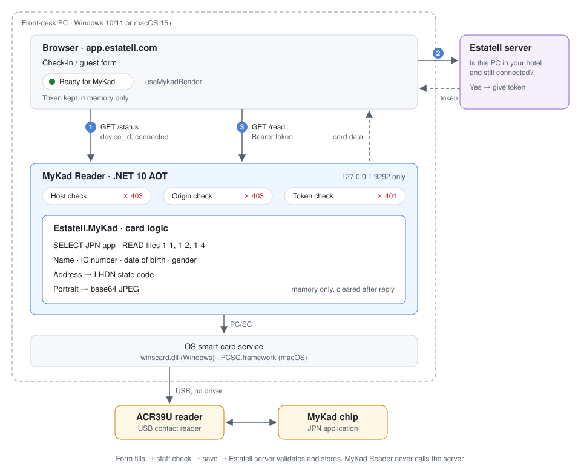

# MyKad Reader

A small native app for the hotel front-desk computer. It reads the chip on a guest's MyKad through a USB card reader and fills the Estatell guest form in about 5 seconds, most of it the portrait.

It replaces the Python bridge in `estatell/tools/mykad-bridge/`. Built with .NET 10 (Native AOT) for Windows 10/11 and macOS 15+.

> Status: building. The solution builds. Card reading comes next. See the [checklist](docs/checklist.md).

## Docs

| Doc | What |
| --- | --- |
| [Overview](docs/overview.md) | Purpose, background, decisions, modules |
| [Checklist](docs/checklist.md) | The build plan, one commit per item |
| [01 Card](docs/01-card/01-reading-mykad.md) | Reading the chip, [PC/SC access](docs/01-card/02-pcsc.md) |
| [02 Bridge](docs/02-bridge/01-http-api.md) | HTTP API, [security](docs/02-bridge/02-security.md), [connecting](docs/02-bridge/03-connecting.md) |
| [03 Packaging](docs/03-packaging/01-installers.md) | Installers, [build and release](docs/03-packaging/02-build-and-release.md) |
| [04 Estatell](docs/04-estatell/01-settings-page.md) | Settings page, [app changes](docs/04-estatell/02-app-changes.md), [user docs](docs/04-estatell/03-user-docs.md) |
| [05 Development](docs/05-development/01-setup-and-testing.md) | Setup and testing |
