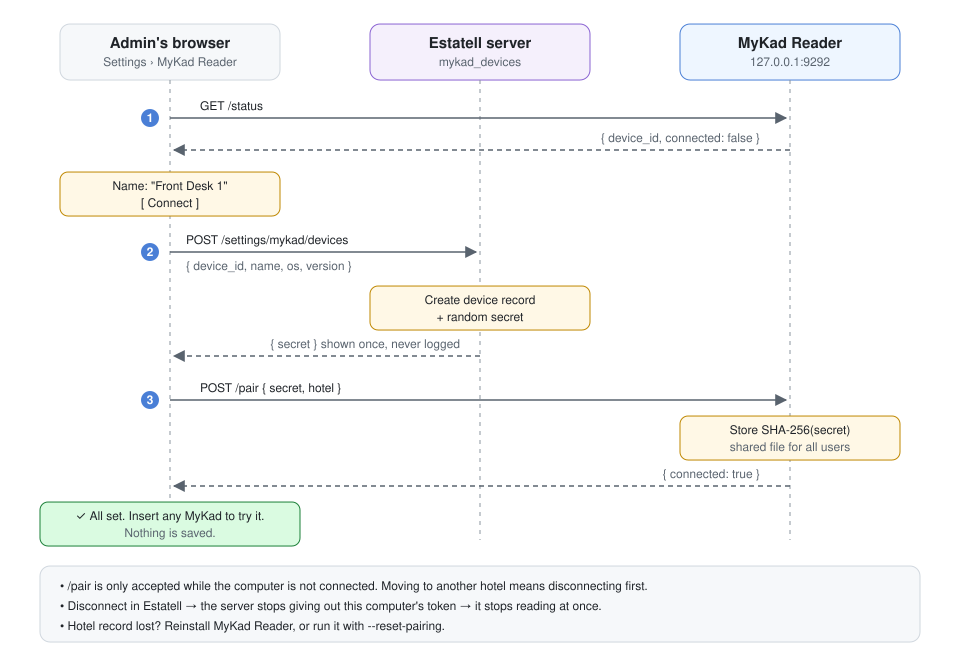

# Connecting

## Purpose

Tie one computer's MyKad Reader to one hotel. Estatell then knows which computers can read cards, and an admin can cut a computer off.

Screens say **connect** and **disconnect**. Code says `pair` and `unpair`.

## Flow

1. The admin opens **Settings → MyKad Reader** on the front-desk computer. The page calls `GET /status` and gets `device_id` and `paired: false`.
2. The admin names the computer, types the connect code from the MyKad Reader [tray menu](04-tray.md#connect-code) and selects **Connect**. The page calls Estatell, which makes a device record and a random 32-byte secret. Estatell returns the secret once.
3. The page sends the secret and the code to `POST /pair`. MyKad Reader checks the code and stores the hash of the secret.

## Reading after connecting

1. The page calls `GET /status` and gets `device_id`.
2. The page asks Estatell for the token of that device. Estatell gives it only if the device belongs to the user's hotel and is not disconnected.
3. The page calls `/read` with the token.

See [How a scan works](../overview.md#how-a-scan-works).

## Rules

- `/pair` works only while not connected. To move a computer to another hotel, disconnect it first.
- `/pair` needs the connect code shown in the tray. Only a person at this computer can see it, so another program or website cannot connect the computer first. After 5 wrong codes `/pair` locks until the admin selects **New connect code** in the tray.
- If the Estatell call in step 2 succeeds but `/pair` fails (wrong code), the page disconnects the new device record (`devices.destroy`), so a retry starts clean.
- Disconnect from Estatell: Estatell sets `revoked_at` and stops giving out the token. The computer stops reading at once. MyKad Reader keeps its hash until the next `/pair` or `/unpair`.
- Disconnect from the computer: the page calls `/unpair` with the token, then tells Estatell.
- One computer, one hotel. See [Open questions](#open-questions).
- If the hotel record is lost, reinstall MyKad Reader or run `--reset-pairing`. See [Token](02-security.md#token) for where the connection is stored.
- MyKad Reader never calls Estatell. The page is always in between.

## Open questions

1. Can one computer connect to two hotels? Some groups run several hotels from one desk.
2. Should Estatell disconnect computers not seen for 90 days?
