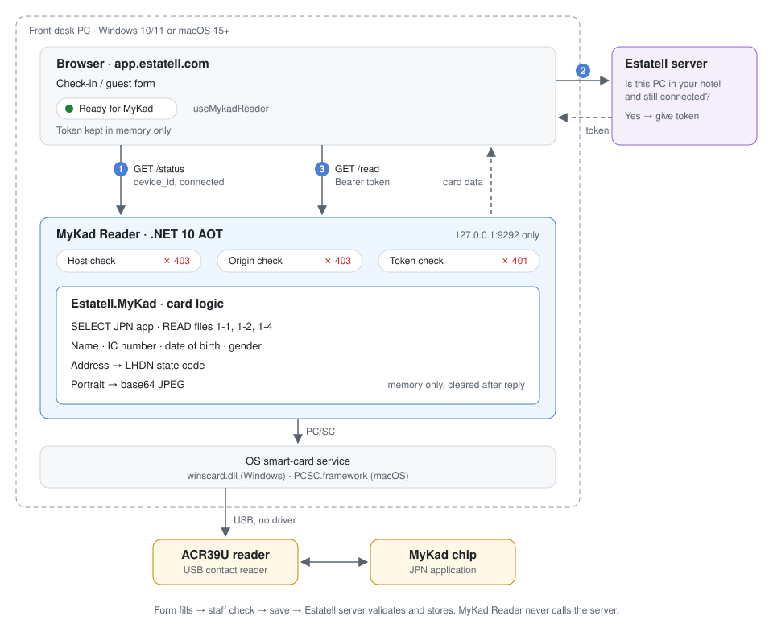

# MyKad Reader overview

## Description

MyKad Reader is a small native app for the front-desk computer. It reads the chip on a guest's MyKad through a USB card reader and gives the result to the Estatell web app. The Estatell guest form fills in about 5 seconds. The card itself sets that speed (see [Read time](01-card/01-reading-mykad.md#read-time)). Staff check the details and save.

A web page cannot talk to a USB card reader. MyKad Reader does it and answers Estatell over HTTP on `127.0.0.1:9292`. Developer docs call it **the bridge**. Screens and user docs call it **MyKad Reader**.

MyKad Reader shows an icon in the Windows tray and the macOS menu bar. Its menu shows the status, the hotel it is connected to and, while not connected, the connect code. It has no window. See [Tray](02-bridge/04-tray.md).

## Background

Estatell has a Python bridge today: `estatell/tools/mykad-bridge/mykad_bridge.py` (version 1.1.0), bundled with PyInstaller. It works, but:

- Antivirus tools often flag unsigned PyInstaller programs.
- Each build bundles a Python runtime.
- Any Estatell tab on any computer can read a card. Estatell does not know which computers have a reader.
- Staff are asked to download the bridge from the check-in page.

MyKad Reader 2.0.0 replaces it. The Python bridge is removed after 2.0.0 ships.

## Decisions

| Topic         | Decision                                                                                              |
| ------------- | ----------------------------------------------------------------------------------------------------- |
| Approach      | A local app that the Estatell page calls over HTTP (the bridge)                                       |
| Language      | .NET 10 LTS, C#, Native AOT. One native file, no runtime to install                                   |
| Platforms     | Windows 10 and 11 (x64, arm64), macOS 15 or later (Apple Silicon and Intel)                           |
| Older PCs     | Windows 7 and 8 are not supported. Hotels upgrade their devices                                       |
| Connecting    | Each computer connects to one hotel with the code shown in the tray. Reading a card needs that connection from 2.0.0 |
| Tray          | Native on each OS: Win32 `Shell_NotifyIcon` on Windows, `NSStatusItem` on macOS. Icon and menu only, no window, no Quit |
| Setup         | An admin does it in **Settings → MyKad Reader** in Estatell. Check-in shows a status only            |
| Install help  | In the Estatell user docs. The app links to it                                                        |
| Downloads     | GitHub Releases                                                                                       |
| Code signing  | None for now (no budget). The user docs explain the confirm prompts                                   |
| Wording       | Plain words on screens: "MyKad Reader", "connect", "confirm". See [Words on screen](04-estatell/01-settings-page.md#words-on-screen) |
| Python bridge | Removed after 2.0.0. Used only to compare output in M0                                                |

## How a scan works

1. The browser asks MyKad Reader for its status and `device_id`.
2. The browser asks the Estatell server for this computer's token. The server gives it only if the computer belongs to the user's hotel and is still connected.
3. The browser asks MyKad Reader to read the card, with the token. MyKad Reader checks Host, Origin and token, reads the chip and returns the data.

The Estatell server validates and stores everything. MyKad Reader never calls the server.

## Modules

| Module                                 | Doc                                                                                                                                                  |
| -------------------------------------- | ---------------------------------------------------------------------------------------------------------------------------------------------------- |
| 01 Card                                | [Reading a MyKad](01-card/01-reading-mykad.md), [PC/SC access](01-card/02-pcsc.md)                                                                   |
| 02 Bridge                              | [HTTP API](02-bridge/01-http-api.md), [Security](02-bridge/02-security.md), [Connecting](02-bridge/03-connecting.md), [Tray](02-bridge/04-tray.md)    |
| 03 Packaging                           | [Installers](03-packaging/01-installers.md), [Build and release](03-packaging/02-build-and-release.md)                                                |
| 04 Estatell                            | [Settings page](04-estatell/01-settings-page.md), [App changes](04-estatell/02-app-changes.md), [User docs](04-estatell/03-user-docs.md)              |
| 05 Development                         | [Setup and testing](05-development/01-setup-and-testing.md)                                                                                          |

The build plan is in [checklist.md](checklist.md).

## Not in scope

- Linux.
- Code signing (later, when there is a budget).
- Reading passports or other ID cards.
- A window on the front-desk computer. The tray menu is the only screen MyKad Reader has.
- MyKad Reader calling the Estatell server.
